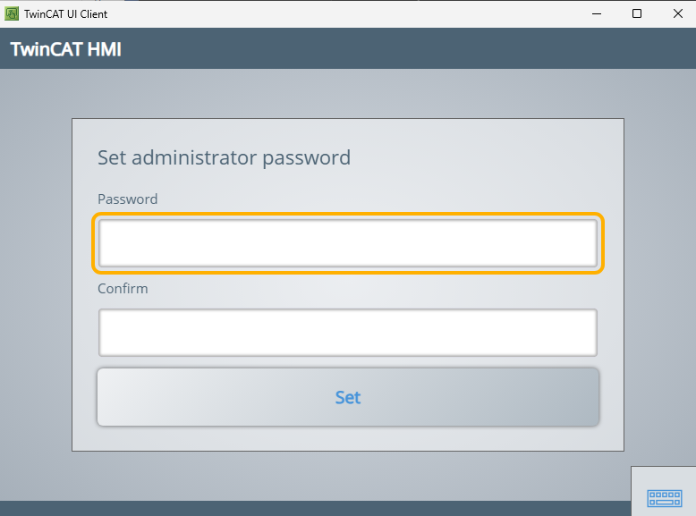

# TF1200 UI Client - CSS Override

## Disclaimer

This guide is a personal project and not a peer-reviewed publication or sponsored document. It is provided "as is," without any warranties—express or implied—including, but not limited to, accuracy, completeness, reliability, or suitability for any purpose. The author(s) shall not be held liable for any errors, omissions, delays, or damages arising from the use or display of this information.

All opinions expressed are solely those of the author(s) and do not necessarily represent those of any organization, employer, or other entity. Any assumptions or conclusions presented are subject to revision or rethinking at any time.

Use of this information, code, or scripts provided is at your own risk. Readers are encouraged to independently verify facts. This content does not constitute professional advice, and no client or advisory relationship is formed through its use.

## Description

An extension for the TwinCAT UI Client (TF1200) which injects your own CSS into whatever page the client is displaying - the overview page, a TwinCAT HMI, a device manager, any URL. CSS files are read from disk and re-applied the moment you save them, without reloading the page.

A worked example is included: `css/hmi-gloves.css` enlarges the touch targets of the TwinCAT HMI server pages so they can be operated while wearing gloves.

Verified against UI Client 1.13.1 (Electron 31.3.1), configuration version 1.13.

## Screenshot

The HMI server's "Set administrator password" page with `css/hmi-gloves.css` applied - 56px fields, a 64px button and a focus ring the operator can see from a distance.



## Getting Started

### Dependencies

- **TwinCAT UI Client (TF1200)** 1.13 or later
- No npm packages. The extension uses only what the UI Client already provides.

### Installation

1. Copy this folder to the UI Client's extension directory:

   ```
   %AppData%\Beckhoff\TF1200-UI-Client\extensions\CssOverride
   ```

2. Register it in `%AppData%\Beckhoff\TF1200-UI-Client\config.json`:

   ```json
   "extensions": {
       "CssOverride": {
           "name": "CssOverride",
           "version": "^1.0.0",
           "directory": "~/AppData/Roaming/Beckhoff/TF1200-UI-Client/extensions/CssOverride",
           "enabled": true,
           "options": {
               "cssFiles": ["css/default.css"],
               "rules": [
                   { "match": "*/overview/index.html*", "files": ["css/overview-dark.css"] },
                   { "match": "*://127.0.0.1:13000/*", "files": ["css/hmi-gloves.css"] }
               ],
               "watch": true,
               "enabled": true
           }
       }
   }
   ```

3. Restart the UI Client.

> [!IMPORTANT]
> The key (`CssOverride`) is the external name used in messages from the page and **must** equal the `name` in both `config.json` and `CssOverride.Config.json`. `version` is a semver _range_ which the manifest version has to satisfy, so a mismatch here stops the extension loading at all.

## Usage

Edit `css/default.css`, save, and the change appears immediately - no restart, no page reload.

### Options

| Option | Default | Meaning |
| --- | --- | --- |
| `cssFiles` | `["css/default.css"]` | Applied to every page. Paths are relative to this directory. |
| `rules` | `[]` | Per-URL CSS, see below. |
| `watch` | `true` | Re-apply automatically when a CSS file is saved. |
| `enabled` | `true` | Whether the override starts active. |
| `logFile` | `"cssoverride.log"` | Diagnostics file; `null` disables it. |

### URL rules

Each rule applies additional CSS only to matching URLs. `match` is compared against the full URL with `*` and `?` as wildcards, case-insensitively:

```json
"rules": [
    { "match": "*/overview/index.html*", "files": ["css/overview-dark.css"] },
    { "match": "https://192.168.0.10/*", "files": ["css/machine-hmi.css"] },
    { "match": "*/Login*", "css": "body { background: #202020 !important; }" }
]
```

> [!NOTE]
> URLs reach the extension percent-encoded, as the page sees them: `file:///C:/Program%20Files%20(x86)/.../overview/index.html`. Matching against `*/overview/index.html*` avoids having to encode anything yourself.

When any rule is configured, the renderer also notices in-page navigation of a single page application (such as a TwinCAT HMI changing its route) and re-asks for the CSS of the new URL.

### Developer console

In the developer tools of the page (`toggleDevToolsKeys` in `config.json` sets the key) the renderer exposes a small handle:

```js
__CssOverride.refresh()                       // re-read and re-apply
__CssOverride.apply("body{background:red}")   // try CSS without touching a file
__CssOverride.clear()                         // remove the override
__CssOverride.toggle()                        // switch the extension on/off
__CssOverride.css                             // the CSS currently applied
__CssOverride.method                          // "adoptedStyleSheets" or "styleElement"
```

### Menu items

The manifest declares `CSS override active` (`Ctrl+Alt+C`) and `Reload CSS files` (`Ctrl+Alt+R`). The UI Client only builds an application menu when `"enableMenuBar": true` and kiosk mode is off, so these items stay inactive until the menu bar is enabled. The extension works regardless; the menu is only a convenience.

## Included stylesheets

| File | Applied to | Purpose |
| --- | --- | --- |
| `css/default.css` | every page | Examples, mostly commented out |
| `css/overview-dark.css` | the built-in overview page | Demo dark appearance |
| `css/hmi-gloves.css` | `127.0.0.1:13000` | Glove-friendly touch targets, see below |

### Glove-friendly HMI pages

The HMI server sizes every control from one rule in `config_modern.css`:

```css
input, button, textarea, select { height: 22px }
```

22px is roughly 6mm on a typical 15" 1024x768 panel, far below what a gloved fingertip can hit reliably. Recommendations for industrial touch panels put the minimum at about 15mm, so `css/hmi-gloves.css` raises it. Measured on the server initialization page:

| | Before | After |
| --- | --- | --- |
| Password / text fields | 22px tall, 230px wide | 56px tall, full width |
| Primary button | 22px | 64px |
| On-screen keyboard keys | 50 x 50px | 65 x 65px |
| Keyboard toggle tab | 50 x 49px | 76 x 72px |
| Control text | 12px | 17px |

It also stacks each label above its field (the HMI's own layout below 769px, which suits gloves better), adds a loud focus ring so the operator can see which field the keyboard types into, gives every button a visible pressed state - gloves provide no tactile feedback - and widens the scrollbars.

Everything is tunable through the variables at the top of the file: `--glove-target`, `--glove-target-lg`, `--glove-font-control`, `--glove-key-grid-height` and so on. Save the file and the running client re-applies it immediately.

Two things worth knowing before editing it:

- The login rows have a fixed 45px height with `overflow: hidden`, so taller fields are clipped unless the row is released as well. That is handled, but keep it in mind for new fields.
- The keyboard section documents a dependency. The HMI slides the closed keyboard out of view using an offset it measures at load time, and the stylesheet pins the keyboard's height and restates that offset to match. If you change `--glove-key-grid-height` the offset follows automatically, but do not override the keyboard's padding or border without redoing the sum.

> [!NOTE]
> This covers the HMI **server** pages (login, server initialization, configuration UI). A running HMI **project** renders its own controls with different class names (`.TcHmi_Controls_*`, `.tchmi-*`), so it needs its own rules. `css/default.css` has commented examples to start from.

## How It Works

The UI Client splits an extension into two halves, and only the second one can touch the page:

- The **entry point** (`main.js`) is forked as a plain Node.js child process. It has full file-system access but no DOM.
- The **renderer script** (`renderer.js`) is injected into the page itself, after the DOM has loaded and the `tcuiclient` API is available. It has the DOM but no Node.js.

So `renderer.js` asks `main.js` for the CSS belonging to its own URL (`tcuiclient.postMessage("CssOverride.getCss", ...)`), and `main.js` pushes a `CssOverride.cssChanged` event whenever a file changes on disk, upon which the renderer asks again and re-applies. That is the live reload.

The CSS is injected as a **constructed stylesheet** via `document.adoptedStyleSheets`. Two reasons:

- Adopted stylesheets are applied _after_ all stylesheets of the document, so your rules win over the page's own rules of equal specificity, including stylesheets the page adds later.
- They are not affected by a `Content-Security-Policy` which forbids inline `<style>` elements, which a hardened HMI server may well send.

If constructed stylesheets are unavailable, it falls back to a `<style>` element which a `MutationObserver` keeps as the last child of `<head>`.

Specificity still applies normally: where the page uses `!important`, you need `!important` too.

### Files

| File | Runs as | Purpose |
| --- | --- | --- |
| `CssOverride.Config.json` | - | Extension manifest, validated by the UI Client against its own schema |
| `main.js` | Node.js child process | Reads and watches the CSS files, picks the ones matching the URL |
| `renderer.js` | inside the displayed page | Injects the CSS into the document |
| `css/` | - | The stylesheets themselves |

## Diagnostics

`cssoverride.log` in this directory records startup, which files are watched, every change, and what the renderer actually applied:

```
... renderer applied 2329 bytes / 3 rules via adoptedStyleSheets for file:///.../overview/index.html (css/default.css, css/overview-dark.css)
```

`rules` is the number of rules the browser parsed. If it is `0` while `bytes` is not, the CSS is syntactically invalid or the injection was blocked.

Errors from the extension also land in the UI Client's own `%AppData%\Beckhoff\TF1200-UI-Client\log\extensions.log.json`. The UI Client logs anything an extension writes to `stderr` as an error and discards `stdout`, which is why this extension keeps its own log.

To debug `main.js` with a Node.js debugger, add `"debugPort": 9229` to the extension entry in `config.json`. The extension then waits for a debugger to attach before starting.

## Removing It

Set `"enabled": false` in the extension entry in `config.json`, or delete the `CssOverride` entry from `extensions` entirely.

## License

MIT - free to use, modify, and distribute.
